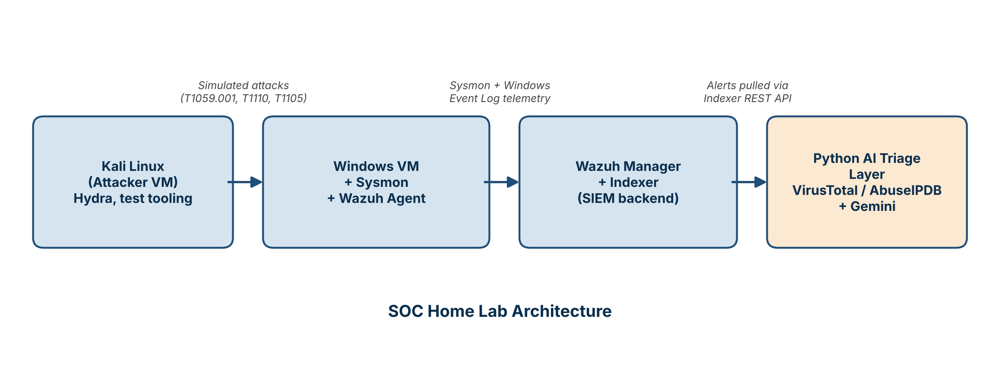

# SOC Home Lab: SIEM Alert Investigation with AI-Assisted Triage

> *Note: this writeup was drafted by hand and polished/edited with AI assistance.*

A self-built Security Operations Center environment used to practice detection engineering, alert triage, and MITRE ATT&CK-based attack simulation, extended with a Python pipeline that integrates threat-intelligence enrichment and LLM-assisted triage.

The lab consists of three VMs on an isolated internal network: a Wazuh SIEM, a Windows endpoint instrumented with Sysmon, and a Kali Linux attacker host used to run MITRE ATT&CK technique simulations via Atomic Red Team. A Python script pulls alerts directly from the Wazuh Indexer API, enriches indicators through VirusTotal and AbuseIPDB, and uses an LLM to draft triage summaries for analyst review.

## Environment

| Component | Role |
|---|---|
| Kali Linux | Attacker VM, used for brute-force testing (Hydra) and running Atomic Red Team |
| Windows 10 VM | Victim endpoint, instrumented with Sysmon (SwiftOnSecurity config), enrolled as a Wazuh agent |
| Wazuh Manager + Indexer | Single-node SIEM (OVA deployment) with default MITRE ATT&CK-mapped detection rules |
| Python triage pipeline | Pulls alerts from the Wazuh Indexer API, enriches via VirusTotal/AbuseIPDB, drafts summaries via Google Gemini |

All VMs run on an isolated internal network with no outbound internet access by default.

## Attack Simulation Results

11 MITRE ATT&CK techniques were executed via Atomic Red Team, spanning six tactics: Credential Access, Discovery, Defense Evasion, Execution, Persistence, and Privilege Escalation. The goal was breadth across the kill chain rather than repeated testing of a single technique.

<table border="1" cellpadding="8" cellspacing="0">
<thead>
<tr>
<th>Technique</th>
<th>Tactic</th>
<th>Detection Evidence</th>
<th>Confidence</th>
</tr>
</thead>
<tbody>
<tr>
<td>T1003.002 &ndash; Credential Dumping (SAM hive)</td>
<td>Credential Access</td>
<td>PowerShell copying the SAM hive from VSS, and reg.exe dumping it directly. Two independent rules fired, both high severity.</td>
<td>High</td>
</tr>
<tr>
<td>T1016 &ndash; Network Config Discovery</td>
<td>Discovery</td>
<td>Generic "system information discovery" rule, moderate severity.</td>
<td>Moderate</td>
</tr>
<tr>
<td>T1036.003 &ndash; Masquerading</td>
<td>Defense Evasion</td>
<td>Sysmon flagged processes renamed to impersonate <code>lsm.exe</code>, <code>svchost.exe</code>, and <code>lsass</code>, caught by its built-in naming heuristics.</td>
<td>High</td>
</tr>
<tr>
<td>T1047 &ndash; Windows Management Instrumentation</td>
<td>Execution</td>
<td>No technique-specific rule fired. Only generic, low-severity noise.</td>
<td><strong>Gap: no rule exists for this in the default ruleset</strong></td>
</tr>
<tr>
<td>T1053.005 &ndash; Scheduled Task</td>
<td>Execution / Persistence / PrivEsc</td>
<td>Strong supporting signals (base64 in registry, script dropped in AppData), but no dedicated "task created" rule.</td>
<td>Partial</td>
</tr>
<tr>
<td>T1059.001 &ndash; PowerShell</td>
<td>Execution</td>
<td>Base64-encoded command spawning a secondary PowerShell process, matching the obfuscation pattern the rule targets.</td>
<td>High</td>
</tr>
<tr>
<td>T1059.003 &ndash; Command Shell</td>
<td>Execution</td>
<td>Only generic process-chaining alerts, indistinguishable from routine admin scripting.</td>
<td>Low / generic only</td>
</tr>
<tr>
<td>T1136.001 &ndash; Create Local Account</td>
<td>Persistence</td>
<td><code>net1.exe</code> user-creation command detected directly.</td>
<td>High</td>
</tr>
<tr>
<td>T1543.003 &ndash; Create/Modify Windows Service</td>
<td>Persistence / PrivEsc</td>
<td>New service creation plus registry evidence, with multiple corroborating signals.</td>
<td>High</td>
</tr>
<tr>
<td>T1547.001 &ndash; Startup Folder Persistence</td>
<td>Persistence / PrivEsc</td>
<td>PowerShell copying an executable into the Windows startup folder, a specific, high-severity match.</td>
<td>High</td>
</tr>
<tr>
<td>T1548.002 &ndash; UAC Bypass (FodHelper)</td>
<td>PrivEsc / Defense Evasion</td>
<td>Five correlated rules: the FodHelper invocation, the specific registry key associated with the bypass, and the auto-elevation behavior itself.</td>
<td><strong>Very high &ndash; full attack-chain correlation</strong></td>
</tr>
</tbody>
</table>

 

**Summary:** 9 of 11 techniques produced a specific, technique-level detection. 1 technique (T1047) revealed a genuine gap in the default ruleset. 1 (T1053.005) had only partial supporting evidence.

## Key Finding: A Systemic False Positive

Across all 11 test runs, Wazuh rule 92213 ("executable dropped in a folder commonly used by malware," severity 15, the highest in the ruleset) fired as the top-severity alert every single time, regardless of which technique was being tested.

Root cause analysis traced this to Atomic Red Team's PowerShell-based execution harness, which creates a housekeeping file (`__PSScriptPolicyTest_*.ps1`) in the Temp directory on every run as part of PowerShell's own script-policy validation. The rule flags any file in that path as malware-like based on location alone, with no file-content or hash verification, making it a predictable false positive rather than a genuine detection.

**Recommended fix:** add an exception for PowerShell's known policy-test file pattern, or convert the rule from path-based to content/hash-based detection logic.

## AI-Assisted Triage Pipeline

To evaluate how LLM-assisted triage performs against real alert data, a Python pipeline was built with the following flow:

1. Pull recent alerts from the Wazuh Indexer API.
2. Enrich any file hash or IP found in an alert via VirusTotal and AbuseIPDB.
3. Submit the enriched alert to Google Gemini for a draft summary, a suggested triage category, and a likely MITRE mapping.
4. Review and finalize every draft manually before acceptance.

**Results:** the model's drafts were accurate on straightforward cases (e.g., correctly identifying benign DNS timeout alerts). However, it produced **inconsistent triage labels on functionally identical alerts** (same rule, same host, seconds apart), labeling one instance "likely false positive" and a near-identical instance "needs escalation." This demonstrates why LLM-drafted triage requires analyst verification rather than autonomous action, and is documented here as a limitation rather than omitted.

## Technical Challenges and Resolutions

| Issue | Root Cause | Resolution |
|---|---|---|
| Wazuh VM hung indefinitely on boot splash screen | OVA imported with an outdated virtual hardware compatibility level (6.5-7.x) incompatible with the current VMware Workstation build | Removed an unused floppy device and upgraded the VM's hardware compatibility version |
| Alerts were not appearing in the dashboard for an extended period, despite a healthy agent connection | VMware Tools time synchronization was disabled on the Wazuh VM; the system clock had drifted after several power cycles, so alerts were timestamped outside the dashboard's active time-range filter | Enabled host time synchronization in VMware Tools across all VMs and verified clock alignment |
| Indexer API was unreachable from outside the VM | OpenSearch was bound to <code>127.0.0.1</code> only, confirmed via <code>ss -tlnp</code> | Set <code>network.host: 0.0.0.0</code> in the OpenSearch configuration and restarted the service |
| Free-tier LLM API calls failed intermittently (404s, then 503s/timeouts) | Incorrect model name and authentication method initially; underlying free-tier model experienced genuine server-side overload under normal use | Corrected the model name/auth header per the provider's own working example, then implemented retry logic with exponential backoff |
| Windows audit-policy configuration tool (<code>secpol.msc</code>) was unavailable | Tool is excluded from Windows 10/11 Home edition | Used the <code>auditpol</code> command-line equivalent, which provides identical functionality across all editions |
| Several Atomic Red Team tests failed with missing-module errors | Tests referenced external tools (e.g., BloodHound/SharpHound) not bundled by default | Identified the dependency and substituted self-contained test cases where appropriate |

## Planned Improvements

- Add detection coverage for WMI-based execution (T1047), identified as a gap in the current ruleset.
- Remediate the AppData/Temp false-positive rule (92213) rather than only documenting it.
- Extend the enrichment pipeline to surface Wazuh's `syscheck`-specific fields for file-integrity alerts, which were not available to the AI triage layer in this iteration.
- Extend the lab to ingest cloud logs (AWS CloudTrail) into the same Wazuh instance to practice hybrid on-premises and cloud detection.

---

**Stack:** VMware Workstation, Wazuh 4.14, Sysmon, Atomic Red Team, Python, VirusTotal API, AbuseIPDB API, Google Gemini API

**Contact:** Prasanna Venkatesh S | [linkedin.com/in/undestined](https://linkedin.com/in/undestined) | [tryhackme.com/p/undestined](https://tryhackme.com/p/undestined)
